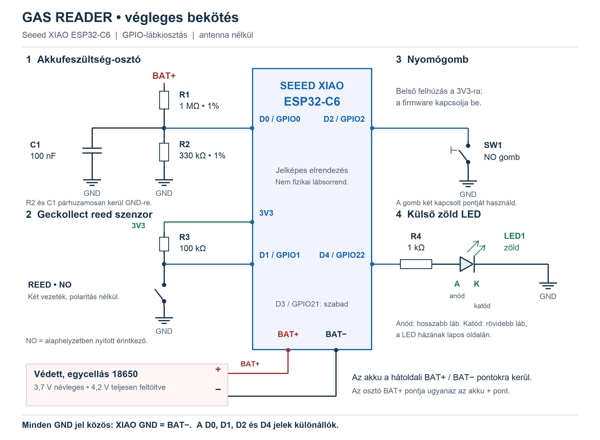

# Gas Reader – magyar összefoglaló

A projekt Seeed XIAO ESP32-C6 alapú, akkumulátoros gázóraimpulzus-olvasó. Saját ESP-IDF firmware-t és Wi-Fi/MQTT-n kommunikáló Home Assistant integrációt tartalmaz. Az alap impulzusérték **0,01 m³**, de ezt a konkrét órán ellenőrizni kell.

A nyilvános repóban a források és dokumentációk vannak. A `.bin` fájlok, a `config.local.json`, a titkokat tartalmazó `provisioning/`, a buildmappák, a helyi IDE-beállítások és a `dist/` kiadási csomagok ignore-on vannak. A firmware-t helyben kell fordítani; a HA-komponens közvetlenül a forrásmappából telepíthető.

## Útmutatók

- [Bekötés és alkatrészlista](docs/HARDWARE.md)
- [Teljes telepítési sorrend](docs/INSTALL.md)
- [ESP-IDF, VS Code, build, USB és OTA](docs/ESP_IDF.md)
- [Konfigurációs mezők és NVS](docs/CONFIGURATION.md)
- [Home Assistant, fogyasztás, óraállítás és mentés](docs/HOME_ASSISTANT.md)
- [MQTT-protokoll](docs/PROTOCOL.md)
- [Tesztek és hardveres ellenőrzés](docs/TESTING.md)
- [GitHub-feltöltés](docs/PUBLISHING.md)

[Nagyítható magyar SVG](docs/wiring.svg) · [Angol SVG](docs/wiring-en.svg)

## Rövid működési összefoglaló

- Normál módban rövid gombnyomás: szinkron; öt másodperces nyomás: admin/OTA.
- Admin módból a belépő nyomás felengedése utáni új rövid nyomással vagy a webes Kilépés gombbal lehet kilépni.
- Induló admin módban villog a LED; a kész oldalnál folyamatosan világít.
- Fogyasztás esetén 30 perces szinkron, fogyasztás nélkül is napi életjel 23:55 magyar idő szerint. Az időt a HA ACK-ja adja; idő nélkül 24 órás ütemezés működik.
- Hidegindításkor egyszer megpróbál szinkronizálni és időt tanulni; sikertelen napi kísérletet 30 perc múlva ismétel.
- A HA **Gázfogyasztás** szenzorát használd az Energy dashboardon. A külön **Gázóraállás** kézzel korrigálható, és a korrekció nem számít fogyasztásnak.
- A Számláló reset az ESP függő impulzusait törli; a HA beállított óraállását és korábbi fogyasztását megőrzi.
- **Áramkimaradáskor a legutóbbi flashmentés óta gyűlt impulzusok elveszhetnek.** A hardveres időzítést és áramfelvételt élesítés előtt mérni kell.

Aktuális forrásverziók: firmware 1.5.0, HA-integráció 1.6.0. A részletes, angol nyelvű belépési pont a [README](README.md).

## Licenc

A projekt saját forráskódja, dokumentációja és bekötési rajzai [MIT licenc](LICENSE) alatt érhetők el. Copyright (c) 2026 wzsolt. A külső függőségek saját licencei megmaradnak.
