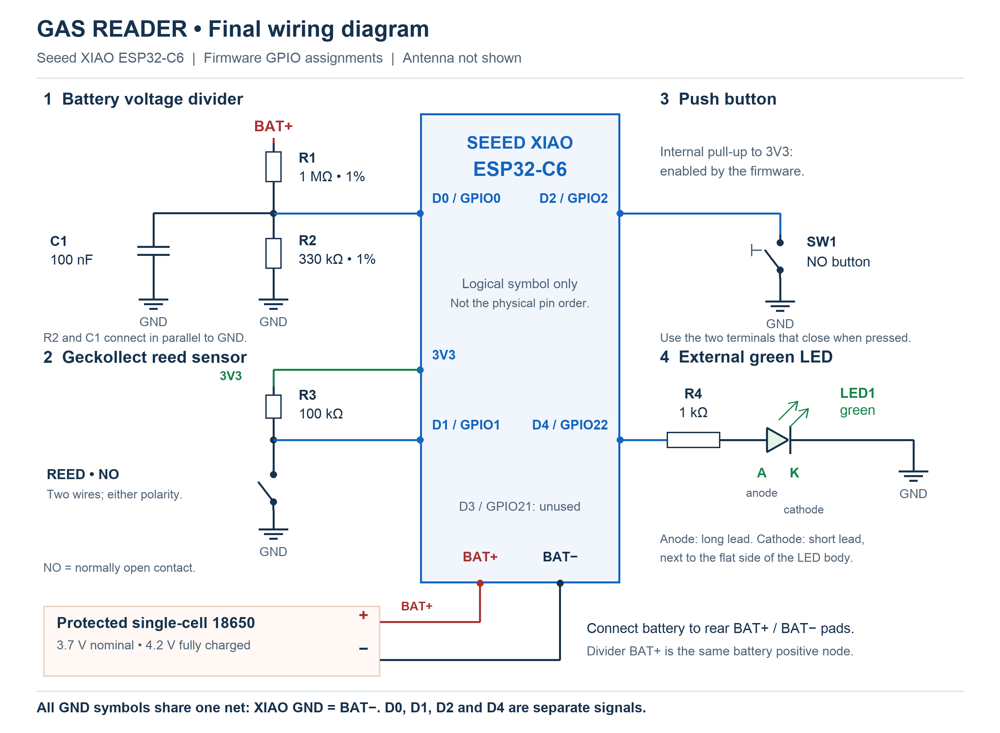

# Gas Reader

Battery-powered gas-meter pulse reader for the **Seeed XIAO ESP32-C6**, with ESP-IDF firmware and a local Home Assistant custom integration over Wi-Fi/MQTT.

[Magyar összefoglaló](README.hu.md)



This is a source repository. Firmware binaries, generated NVS images, local configuration, SDK installations and release archives are excluded from Git. Build the firmware locally and install the Home Assistant integration from its source folder.

## What it does

- Counts a two-wire, normally open reed contact, with 30 ms debounce and deep-sleep wake-up.
- Uses **0.01 m³ per pulse** by default; verify the actual meter's pulse constant.
- Sends accumulated pulses every 30 minutes when consumption is pending.
- Performs a daily sync at **23:55 Hungarian local time**, including days with no pulses. Without HA time, it uses a 24-hour interval.
- Tries the primary Wi-Fi first, then an optional fallback network.
- Keeps an immutable MQTT outbox and waits for a durable Home Assistant ACK before clearing its pulses.
- Provides a password-protected local maintenance page with browser OTA, exit and pending-pulse discard controls.
- Separates the editable physical **meter reading** from pulse-only **gas consumption** for the Energy dashboard.
- Reports battery voltage and an estimated battery percentage.

**Power-loss limit:** pulses since the last flash checkpoint may be lost if power is removed. Reset and OTA reboot also have a counting blind interval. Validate pulse timing and sleep current on your own hardware; see [testing](docs/TESTING.md).

## Documentation

| Guide | Contents |
|---|---|
| [Getting started](docs/INSTALL.md) | End-to-end installation order |
| [Hardware and wiring](docs/HARDWARE.md) | BOM, GPIO table, divider, reed, button, LED and antenna control |
| [ESP-IDF setup and flashing](docs/ESP_IDF.md) | SDK/VS Code, build, provisioning, USB install and OTA |
| [Configuration](docs/CONFIGURATION.md) | Every JSON key, Wi-Fi fallback, MQTT credentials and NVS handling |
| [Home Assistant](docs/HOME_ASSISTANT.md) | Manual installation, entities, Energy, corrections, migration and backups |
| [MQTT protocol](docs/PROTOCOL.md) | Reports, ACKs, deduplication, checkpoints and daily time |
| [Tests and hardware validation](docs/TESTING.md) | Repeatable tests and device acceptance checks |
| [Publishing to GitHub](docs/PUBLISHING.md) | Ignore rules, first commit and upload commands |

Wiring downloads: [English SVG](docs/wiring-en.svg) · [English PNG](docs/wiring-en.png) · [Hungarian SVG](docs/wiring.svg) · [Hungarian PNG](docs/wiring.png).

## Quick start

Requirements: XIAO ESP32-C6 with 4 MB flash, the components in the wiring guide, 2.4 GHz Wi-Fi, an MQTT broker and Home Assistant with the MQTT integration configured.

The current firmware is **1.5.0**; the Home Assistant integration is **1.6.0**. Firmware targets **ESP-IDF 6.1.0**, pinned by `firmware/main/idf_component.yml`. The HA adapter test environment is pinned to Home Assistant 2026.9.4 / Python 3.14 in `homeassistant/requirements-test.txt`.

1. Build the circuit following [Hardware](docs/HARDWARE.md).
2. Install the HA integration from `homeassistant/custom_components/gas_reader`; see [Home Assistant](docs/HOME_ASSISTANT.md).
3. Install/select ESP-IDF 6.1.0 and run the following **from the repository root**, using a Bash-capable shell:

```sh
cp -n config.example.json config.local.json
chmod 600 config.local.json
# Edit config.local.json with your own Wi-Fi, MQTT and OTA credentials.
bash tools/build.sh
bash tools/idf-python.sh tools/provision.py config.local.json
bash tools/idf-python.sh -m serial.tools.list_ports -v
```

4. While the board is still on the bench, perform its first USB installation:

```sh
bash tools/idf-python.sh tools/flash_first_install.py --port YOUR_SERIAL_PORT --first-install
```

**First installation overwrites NVS, including saved configuration and counters.** Later application updates should use the maintenance page's OTA upload, which preserves NVS. Do not repeat the first-install command on a live counter.

5. Configure Gas Reader in HA using the device's Wi-Fi MAC as twelve lowercase hex characters. Short-press the external button and verify the reading, consumption and battery entities. Use **Gas consumption**, not the editable meter reading, in Energy.

Detailed instructions, including BOOT/RESET and the disappearing USB port during sleep, are in [ESP-IDF](docs/ESP_IDF.md).

## Button and LED

| State / action | Result |
|---|---|
| Normal mode: short press and release | Immediate sync, including zero pulses |
| Normal mode: hold for 5 seconds | Enter maintenance; ten-minute window |
| Maintenance: release entry press, then short-press and release | Save and exit to sleep |
| Web page: Exit | Save and exit; active OTA/discard is allowed to finish |
| LED blinking, 250 ms on / 250 ms off | Maintenance is initializing / connecting |
| LED steady in maintenance | Wi-Fi has an IP and the web page is ready |
| LED steady during normal sync | Sync is in progress |
| Three flashes | Operation succeeded after ACK/save, or OTA boot verification passed |
| Two flashes | Operation failed |

The web page is `http://gas-reader-<device_id>.local/`, or use the board's DHCP IP. Login: `admin` and your configured `ota_password`.

The **counter reset** button discards the ESP's pending pulse snapshot; it does not zero the HA meter reading or consumption. An already-saved normal report is resolved first, so its previously unprocessed consumption may still be added. See [the discard transaction](docs/PROTOCOL.md#discarding-pending-pulses).

## Development

```sh
bash tools/test.sh
```

Core tests use Clang with AddressSanitizer/UndefinedBehaviorSanitizer. Node.js enables the maintenance-page tests; a separately installed `.venv-ha` enables the real HA adapter tests. Setup is described in [Testing](docs/TESTING.md).

The embedded page is [firmware/main/maintenance.html](firmware/main/maintenance.html). HTML/CSS/JavaScript edits require rebuilding and updating the ESP application.

| Directory | Purpose |
|---|---|
| `firmware/` | ESP-IDF source, defaults, partition table and C/JS tests |
| `homeassistant/` | Custom integration and Python tests |
| `tools/` | Environment discovery, build, provisioning, flashing, diagram generation and packaging |
| `docs/` | Public guides and wiring diagrams |
| `dist/` | Locally generated release artifacts; ignored, absent from a fresh clone |

This implementation uses local `mqtt://` and HTTP Basic authentication, without TLS or signed firmware. Keep the broker and maintenance page on a trusted local network. The daily schedule is configured for Hungary; other time zones require changing `GR_LOCAL_TZ` in `firmware/main/daily_schedule.h` and rebuilding.

## License

This project's original source code, documentation and wiring diagrams are licensed under the [MIT License](LICENSE). Copyright (c) 2026 wzsolt. Third-party dependencies retain their own licenses.
